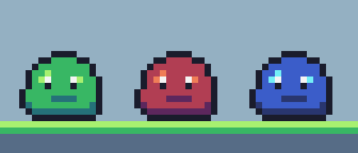
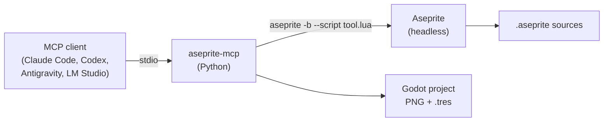

# aseprite-mcp

[](https://github.com/ObsidianTrove/aseprite-mcp/actions/workflows/ci.yml)
[](LICENSE)
[](pyproject.toml)

An [MCP](https://modelcontextprotocol.io) server that lets AI agents create pixel-art game
assets in [Aseprite](https://www.aseprite.org) and export them straight into
[Godot 4](https://godotengine.org) projects.

Sprites, animations, palettes, palette-swapped variants and tilesets, driven from any
MCP-capable client: Claude Code, OpenAI Codex, Google Antigravity, LM Studio with local
models, and others.



*Built entirely through MCP tool calls by [examples/showcase.py](examples/showcase.py).*

## Features

- **Pixel-level drawing** with an ASCII grid op that language models handle reliably, plus
  rectangles, lines, circles and individual pixels
- **Animation**: duplicate frames, set per-frame timing, tag named animations with
  forward / reverse / ping-pong playback and one-shot or looping behaviour
- **Palettes**: apply hex palettes or palette files (e.g. from Lospec), convert to indexed
  color, and generate recolored variants
- **Image import**: bring in concept art or generated images, downscale with nearest-neighbor
  sampling and quantize to a palette
- **Visual feedback**: a `preview` tool returns rendered PNGs so multimodal models can check
  their own work
- **Godot 4 export**: `SpriteFrames` resources with timing preserved, and extruded tilesets
  with a matching `TileSet` resource, ready to drop into a scene
- **Safe by default**: file access is limited to configured folders, and arbitrary Lua
  execution is disabled unless explicitly enabled

## How it works



Each tool call runs a separate headless Aseprite process (`aseprite -b`) with a bundled Lua
script. Arguments and results travel as JSON. Because nothing runs inside the editor, the
server never interferes with an Aseprite window you have open; use **File > Revert** to
reload a file after an agent has changed it.

## Requirements

- [Aseprite](https://www.aseprite.org) 1.3 or newer (Steam or standalone)
- [uv](https://docs.astral.sh/uv/), which also installs a suitable Python (3.11+)
- Any MCP client

## Installation

```sh
git clone https://github.com/ObsidianTrove/aseprite-mcp.git
cd aseprite-mcp
uv sync
```

Check that everything works against your Aseprite installation:

```sh
uv run pytest
```

## Configuration

The server is configured through environment variables, set in your MCP client's server
entry.

| Variable | Default | Purpose |
|---|---|---|
| `ASEPRITE_PATH` | auto-detected | Path to the Aseprite executable. Standard Steam and standalone locations on Windows, macOS and Linux are checked, then `PATH`. |
| `ASEPRITE_MCP_ROOTS` | your home folder | Folders the server may read and write, separated by `;` on Windows and `:` elsewhere. Point this at your game projects. |
| `ASEPRITE_MCP_ALLOW_LUA` | disabled | Set to `1` to enable the `run_lua` tool. |
| `ASEPRITE_TIMEOUT` | `120` | Seconds before a single Aseprite invocation is aborted. |

## Connecting a client

Every client launches the same command:

```sh
uv run --directory /absolute/path/to/aseprite-mcp aseprite-mcp
```

> [!TIP]
> Desktop apps may not see `uv` on their `PATH`, especially if it was installed after the
> app was opened. Restart the app, or use the absolute path to `uv`
> (`where uv` on Windows, `which uv` elsewhere) as the command.

### Claude Code

```sh
claude mcp add aseprite --scope user \
  -e ASEPRITE_MCP_ROOTS=/path/to/game/projects \
  -- uv run --directory /absolute/path/to/aseprite-mcp aseprite-mcp
```

Verify with `claude mcp get aseprite`, or `/mcp` inside a session.

### OpenAI Codex

Add the contents of [examples/clients/codex.toml](examples/clients/codex.toml) to
`~/.codex/config.toml`. This applies to both the CLI and the IDE extension. Verify with
`codex mcp list`.

### Google Antigravity

In the Agent panel, open **… > MCP Servers > Manage MCP Servers > View raw config** and merge
in [examples/clients/mcp.json](examples/clients/mcp.json). The file lives at
`~/.gemini/antigravity/mcp_config.json`.

### LM Studio

Open **Program > Install > Edit mcp.json** (`~/.lmstudio/mcp.json`), merge in
[examples/clients/mcp.json](examples/clients/mcp.json), then enable the `mcp/aseprite`
integration in the chat sidebar.

### Other clients

Cursor, Cline, Continue, Claude Desktop and most other clients accept the same
`mcpServers` JSON shown in [examples/clients/mcp.json](examples/clients/mcp.json).

### Tool approval

Tools carry standard MCP annotations: `sprite_info` and `preview` are read-only; every other
tool writes files. Clients use these hints when deciding what to run without asking. The
Codex example auto-approves the read-only tools; in Claude Code you can allow
`mcp__aseprite__*` in your permission settings for unattended runs.

## Tools

| Tool | Description |
|---|---|
| `create_sprite` | Create an `.aseprite` file with size, frame count, color mode, palette and optional background. |
| `sprite_info` | Size, color mode, frames and durations, layers, tags and palette. |
| `add_layer` | Add a layer or layer group, optionally inside a group. |
| `add_frames` | Append empty or copied frames and set frame durations. Existing tags are preserved. |
| `tag_animation` | Name a frame range as an animation with a playback direction and repeat count. |
| `draw` | Apply drawing ops (`rows`, `pixels`, `rect`, `line`, `circle`, `clear`) to one or more frames. |
| `set_palette` | Set the palette from hex colors or a palette file; optionally convert to indexed color. |
| `palette_swap` | Recolor exact colors across all layers and frames, in place or into a new file. |
| `import_image` | Import a PNG/JPG/GIF, resize with nearest-neighbor sampling and reduce colors. |
| `preview` | Render the sprite (all frames, or one) as a PNG image. |
| `export_spritesheet` | Export a sprite sheet PNG with optional Aseprite JSON metadata. |
| `export_godot_spriteframes` | Export PNG + `SpriteFrames` `.tres` into a Godot project. |
| `export_tileset` | Export an extruded tileset PNG, optionally with a Godot `TileSet` `.tres`. |
| `batch_export` | Re-export every `.aseprite` file in a folder tree into a Godot project. |
| `run_lua` | Run arbitrary Aseprite Lua. Disabled by default. |

Conventions: paths are absolute; frames are 1-based, matching the Aseprite UI; colors are
`#rrggbb` or `#rrggbbaa`.

The `rows` drawing op describes pixel art as text, one character per pixel:

```json
{
  "op": "rows", "x": 4, "y": 2,
  "rows": ["..kk..",
           ".kggk.",
           "kggggk"],
  "key": { "k": "#1a1c2c", "g": "#38b764" }
}
```

## Example prompts

> Create a 16×16 knight sprite using the Sweetie 16 palette in `C:\Games\Quest\art\knight.aseprite`.
> Add a four-frame walk cycle tagged `walk`, preview it, and fix anything that looks off.

> Make red and blue variants of `C:\Games\Quest\art\enemies\slime.aseprite` with
> `palette_swap`, then export all three to my Godot project at `C:\Games\Quest` as
> SpriteFrames.

> Slice `C:\Games\Quest\art\terrain.aseprite` into 16×16 tiles with 1 px extrusion and
> create a Godot TileSet in `C:\Games\Quest\assets\tiles`.

## Using the assets in Godot

1. Export with `export_godot_spriteframes` (or `batch_export` for a whole folder).
2. Add an `AnimatedSprite2D` node, set **Sprite Frames** to the generated `.tres`, and play
   an animation by its Aseprite tag name.
3. For tilesets, use `export_tileset` with `godot_project` and assign the generated `.tres` to
   a `TileMapLayer`. The atlas margins and separation already account for the extrusion.

Recommended project settings for crisp pixel art on desktop and mobile:

| Setting | Value |
|---|---|
| Rendering > Textures > Default Texture Filter | Nearest |
| Display > Window > Stretch > Mode | `viewport` |
| Display > Window > Stretch > Scale Mode | `integer` |
| Base resolution | e.g. 320×180 or 480×270, which scale cleanly to common displays |

Keep exports at scale 1 and let the viewport do the scaling.

## Security model

- Every path must be absolute and inside a folder listed in `ASEPRITE_MCP_ROOTS`; relative
  paths and `..` traversal outside a root are rejected.
- Godot exports are confined to the given project folder.
- `run_lua` can execute arbitrary code with your user's permissions and is off unless
  `ASEPRITE_MCP_ALLOW_LUA=1` is set.
- The server makes no network requests.

## Local models

Tool-calling quality matters more than model size, but very small models struggle with
multi-step workflows. Models from roughly 14B parameters up with dependable tool calling work
well. Give the model at least 16k tokens of context; the tool definitions alone use a few
thousand.

For speed, make sure the model and its context fit entirely in GPU memory. In LM Studio,
an oversized context length or several parallel slots can push the KV cache into system
memory and cut throughput by an order of magnitude; a 32k context, a single slot, flash
attention and a quantized KV cache are good starting points.

## Development

```sh
uv sync                    # install runtime and dev dependencies
uv run pytest              # unit + integration tests
uv run pytest tests/unit   # tests that need no Aseprite installation
uv run ruff check .        # lint
uv run ruff format .       # format
```

Integration tests start the server as a subprocess and exercise every tool over the MCP
protocol against a real Aseprite installation, checking pixel values, image dimensions,
generated Godot resources and error messages. They are skipped automatically when Aseprite
is not found, which is the case in CI.

### Project layout

```
src/aseprite_mcp/
  server.py     MCP tool definitions
  aseprite.py   Aseprite CLI and Lua bridge
  godot.py      Godot .tres generation
  paths.py      path validation
  config.py     environment configuration
  lua/          one script per tool, plus shared helpers in common.lua
tests/
  unit/         pure-Python tests
  integration/  end-to-end tests over MCP stdio
examples/       client configuration and a scripted showcase
```

### Adding a tool

1. Add `src/aseprite_mcp/lua/<tool>.lua` following the pattern in `sprite_info.lua`: call
   `C.run(function(p) ... end)` and return a table.
2. Add a function decorated with `@tool()` in `server.py` that validates paths and calls
   `aseprite.lua("<tool>", ...)`. Its docstring becomes the description the model sees.
3. Add an integration test in `tests/integration/test_tools.py`.

The Aseprite scripting API is documented at <https://aseprite.org/api>.

## Troubleshooting

| Symptom | Fix |
|---|---|
| `Aseprite executable not found` | Set `ASEPRITE_PATH` to the full path of the executable. |
| `... is outside the allowed folders` | Add the folder to `ASEPRITE_MCP_ROOTS` and restart the server. |
| Client cannot start the server | Use the absolute path to `uv` as the command; restart the client. |
| Changes do not appear in the open editor | Use **File > Revert** in Aseprite. |
| Tool calls time out on large batches | Increase `ASEPRITE_TIMEOUT` and the client's tool timeout. |

## License

[MIT](LICENSE)

## Acknowledgements

Aseprite is a trademark of Igara Studio S.A. Godot is a trademark of the Godot Foundation.
This project is not affiliated with or endorsed by either.
